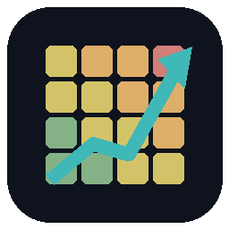
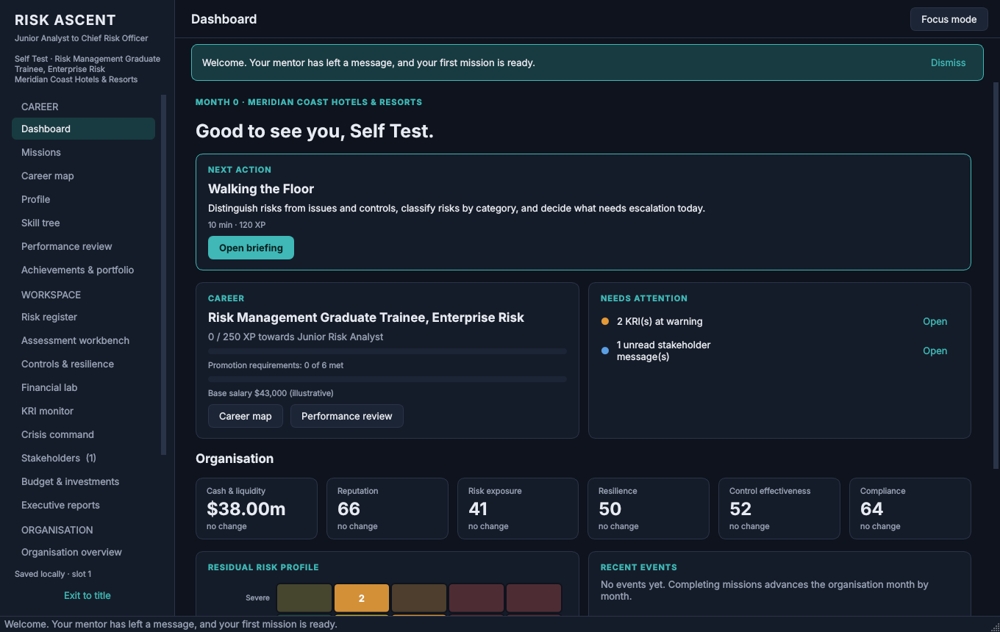
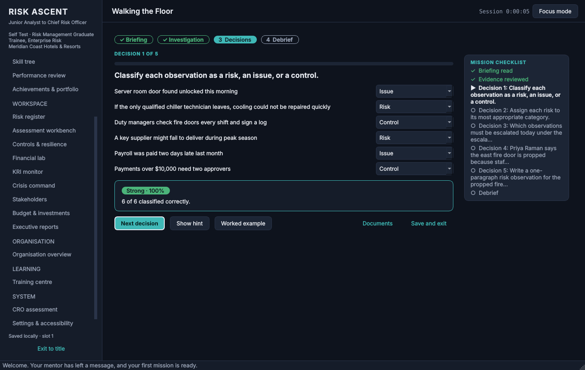
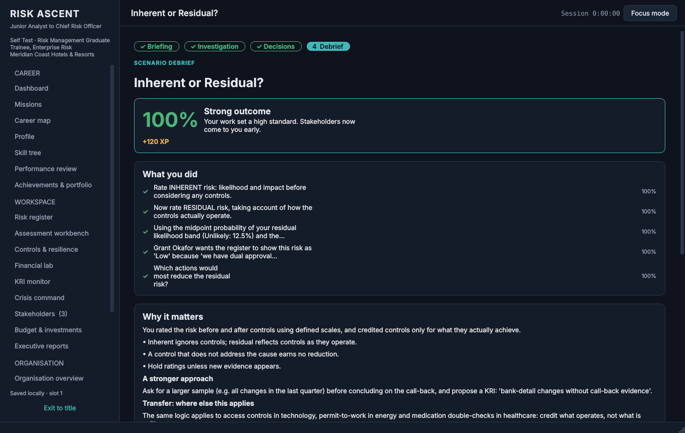
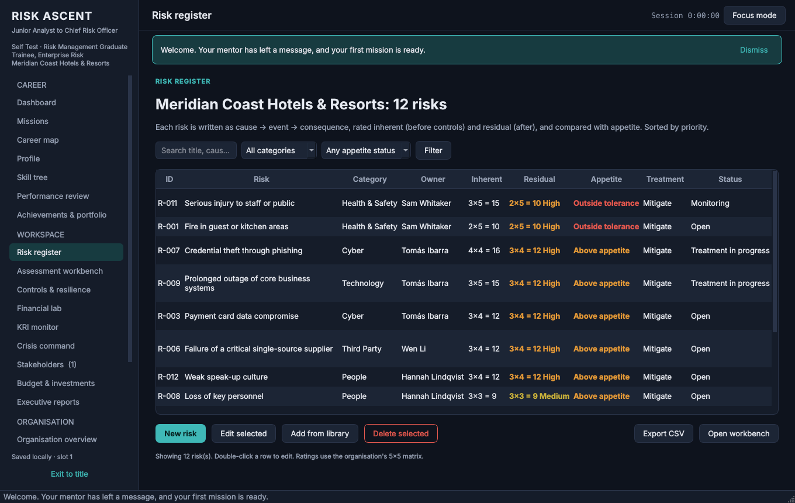
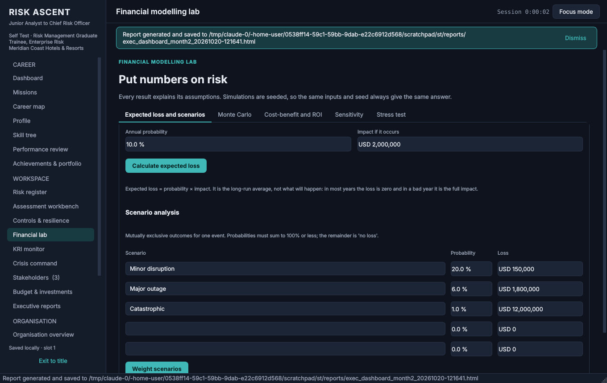
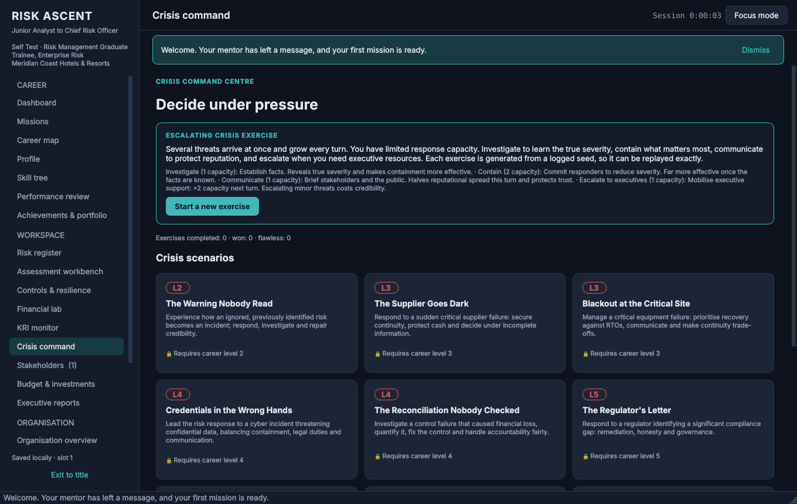
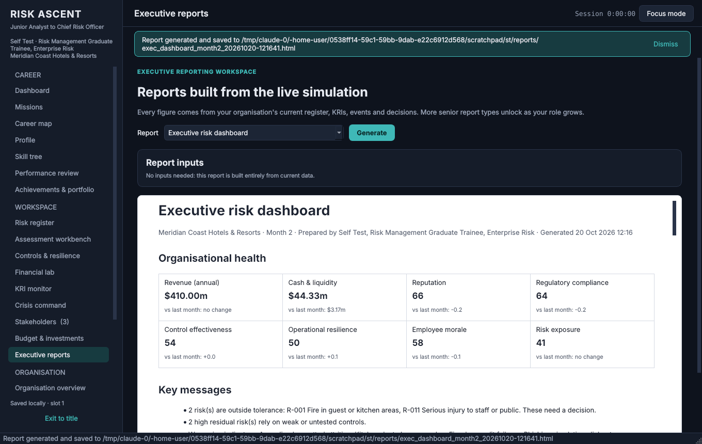
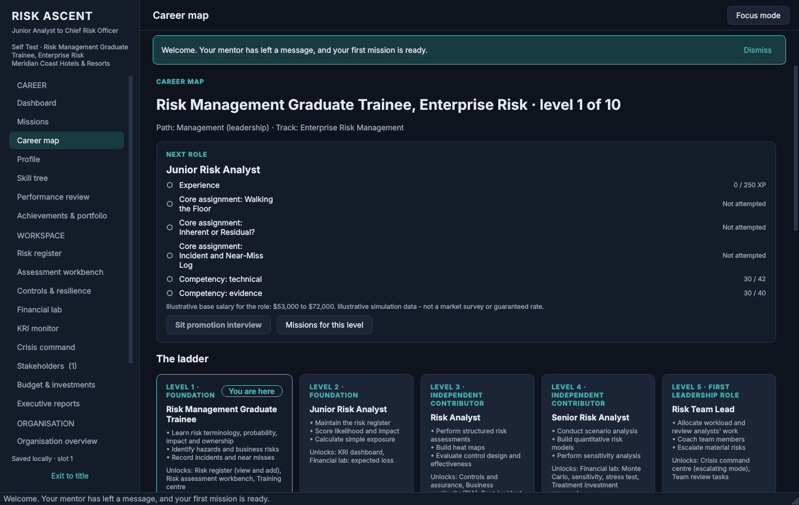
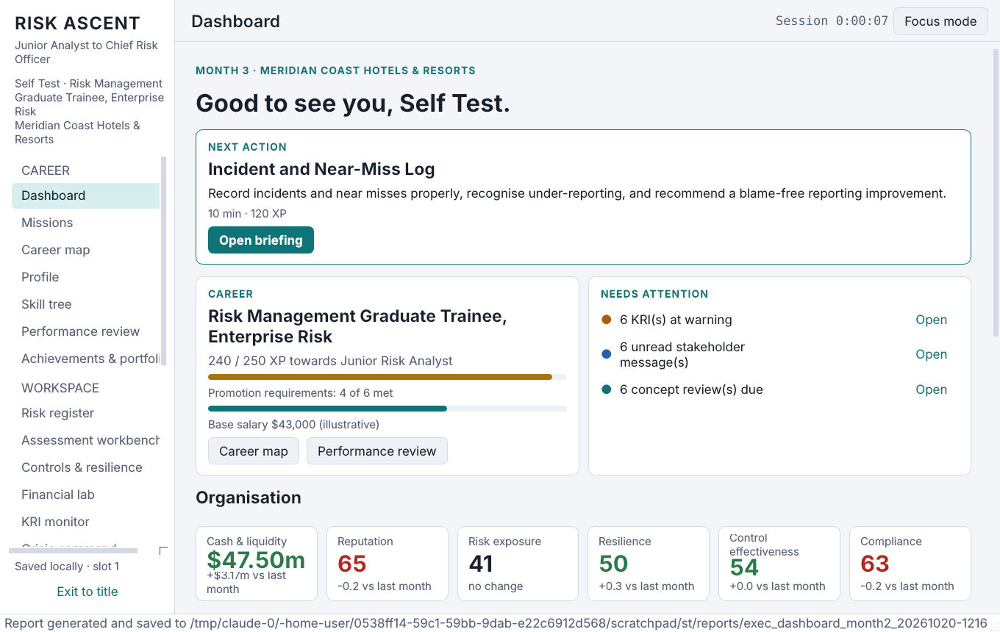

<div align="center">



# Risk Ascent

### From Junior Analyst to Chief Risk Officer

**An offline career simulator for enterprise risk management.**
Start as a graduate trainee in a hotel group's risk team. Make real risk calls, build real tools, live with the consequences, and climb ten levels to the boardroom.

-0e131d)

-3fb8b7)




</div>

---

## Why this game exists

Most risk training is slides and multiple choice. Real risk work is messier: incomplete evidence, executives with their own incentives, budgets that never stretch far enough, and outcomes that are partly luck. Risk Ascent puts you in that world and scores **the quality of your judgement, not the dice**. A sound call that meets bad luck is explained as bad luck; a reckless call that happens to work is called out as a lucky escape.

Every number on screen comes from a live simulation: the risk register you maintain, the KRIs you set thresholds for, the controls you test, the investments you win or lose, and the incidents that follow from what you did (or didn't do) three months earlier.

## At a glance

| | |
|---|---|
| **Career** | 10 levels from Graduate Trainee to Chief Risk Officer, then 7 executive paths (Group CRO, CEO, COO, Board Adviser, Consultant, Chief Resilience Officer, Specialist Risk Executive) |
| **Specialisms** | 10 tracks: ERM, financial, operational, strategic, cyber/technology, project, resilience/BCM, compliance, insurance, HSE |
| **Organisations** | 9 playable organisations across 8 industries, including a full **hotel pack** and a **Saudi Arabia pack** priced in SAR |
| **Content** | 67 missions (30 career, 12 crisis, 12 side, 6 capstones, 7 executive) with **281 decision points** |
| **Progression** | XP, a 5-branch skill tree, 11 competencies, **81 verifiable achievements**, competency-gated promotions, interviews, salary negotiation, performance reviews, a final CRO board simulation and New Game Plus |
| **Privacy** | No network code at all. No accounts, telemetry, ads, or API keys. Saves stay on your PC. |

## Screens

<table>
<tr>
<td width="50%"><br><sub><b>Missions.</b> Briefing → investigation → decisions → debrief, with a live checklist, hints, worked examples and immediate, specific feedback.</sub></td>
<td width="50%"><br><sub><b>Debriefs.</b> What happened, why, the stronger approach, how it transfers to other industries, and whether the outcome was judgement or luck.</sub></td>
</tr>
<tr>
<td><br><sub><b>Risk register.</b> A working register: create, edit, prioritise against appetite, filter by heat-map cell, pull from a library, export to CSV.</sub></td>
<td><br><sub><b>Financial lab.</b> Expected loss, scenarios, Monte Carlo (Poisson × lognormal), cost-benefit with NPV/ROI/payback, tornado sensitivity and liquidity stress tests.</sub></td>
</tr>
<tr>
<td><br><sub><b>Crisis command.</b> 12 scripted crisis scenarios plus a seeded, escalating multi-threat exercise with limited response capacity.</sub></td>
<td><br><sub><b>Executive reports.</b> Eight report types built from your live data, saved as HTML and exportable to PDF and CSV.</sub></td>
</tr>
<tr>
<td><br><sub><b>Career map.</b> Every promotion requirement in plain view: XP, core assignments, capstones and competency minimums for the next role.</sub></td>
<td><br><sub><b>Accessibility.</b> Light, dark and high-contrast themes, 85–160% text, focus mode, reduced motion, read-aloud and full keyboard control.</sub></td>
</tr>
</table>

The full list: title & career slots, dashboard, career map, profile, skill tree, missions, mission player, risk register, assessment workbench, controls & resilience (control testing, findings, BIA), financial lab, KRI monitor, crisis command, stakeholders (inbox + trust map), budget & investments, executive reports, performance review, training centre, achievements & portfolio, organisation overview, settings & accessibility, saves & recovery, CRO assessment, plus the promotion-interview, new-career and backup dialogs.

## Install and play (Windows 10/11, 64-bit)

Download from the [Releases](../../releases) page. You need **one** of these:

| File | What it is |
|---|---|
| `RiskAscent_Setup.exe` | Per-user installer. Installs to `%LOCALAPPDATA%\Programs\RiskAscent`, adds Start-menu (and optional desktop) shortcuts and an uninstaller. **No administrator rights needed.** |
| `RiskAscent.exe` | Portable single file. Put it anywhere and double-click. First start takes a few seconds while it unpacks. |

1. Run the installer (or the portable exe).
2. **Windows SmartScreen will probably warn you**, because the build is **not code-signed**. Choose *More info → Run anyway* only if you downloaded it from this repository's Releases page. You can compare the file against the SHA-256 checksums published with each release.
3. Pick a save slot, enter a display name, choose an organisation, a track and a difficulty, and press **Start career**. The dashboard's *Next action* card always tells you the single most useful thing to do next.

Your progress is saved after every action. To check an install, run `RiskAscent.exe --self-test`; it plays through the game in a throwaway folder and writes a pass/fail report.

## How the game works

**Scored on decisions, not on luck.** Each choice has an authored quality (strong, reasonable, weak or poor). Outcomes are rolled from a recorded seed, and the debrief separates the two: *"This was bad luck, not poor judgement: you would make the same call again."*

**A living organisation.** Your choices change cash, reputation, compliance, control effectiveness, resilience, morale and exposure. They can also schedule future incidents: defer that duct clean, and a kitchen fire becomes possible next month. Stakeholders remember you. Trust with the CFO decides whether your next investment case is approved.

**Promotion is earned, not ground out.** Each promotion needs enough XP, core assignments passed at 60% or more, the stage capstone passed at 70% or more, and minimum competency scores for the next role. Then you sit an interview and negotiate your salary. Your evidence and trust decide what an ambitious ask gets you.

**Learning that sticks.** Concept cards come back on a spaced schedule (1, 3, 7, 14, 30 and 60 days, and you can change it). You rate your confidence and get a calibration chart that shows over- or under-confidence. Worked examples, hints and adaptive scaffolding respond to how you're doing. There are no streaks to protect.

**Three difficulties.** *Guided* (hints and worked examples always on, generous tolerances), *Professional* and *Executive* (no worked examples, tight tolerances, harsher events). An adaptive layer on top offers more support after mistakes and adds stretch material when you're cruising.

See [docs/GAME_DESIGN_AND_SCORING.md](docs/GAME_DESIGN_AND_SCORING.md) for every formula.

## Designed for focus (ADHD-friendly)

- One clear **Next action** on the dashboard, and **focus mode** (F6) that hides everything else.
- Every mission has a visible checklist and progress bar; it can be paused at any step and resumed exactly there, even after a restart.
- An optional session timer with one gentle, dismissible break suggestion. Never a nag.
- Reduced motion, adjustable text size (Ctrl + = / Ctrl + −), light, dark and high-contrast themes, and read-aloud using the voices installed in Windows.
- No dark patterns: no streak loss, no fake urgency, no loot boxes, no currency to buy. Salaries are labelled **illustrative** everywhere.

## Keyboard

| Keys | Action |
|---|---|
| Ctrl + 1 … 9 | Jump to Dashboard, Missions, Register, Workbench, Financial lab, KRIs, Stakeholders, Reports, Training |
| Ctrl + L | Move keyboard focus to the menu |
| Ctrl + , | Settings |
| Ctrl + Enter | Primary action on the current screen (accept, submit, next) |
| F6 / Esc | Focus mode on / off |
| Ctrl + B | Back up now |
| Ctrl + Shift + S | Read the screen aloud (when enabled) |
| F1 | Shortcut list |

## Your data

Everything lives in `%LOCALAPPDATA%\RiskAscent`:

```
saves\slot_1.db … slot_5.db    one SQLite file per career (WAL journal, full sync)
backups\slot_N\*.db            automatic backups after missions, promotions and sessions (newest 15 kept; manual ones kept forever)
reports\                       every report you generate (HTML)
logs\riskascent.log            local log, rotated at 2 MB; never sent anywhere
settings.json
```

Each action is saved inside its own database transaction. If a save is ever damaged, the game moves it aside and recovers from the newest valid backup on its own. Deleting or resetting a career needs you to type a confirmation, and a backup is taken first. See [docs/BACKUP_AND_RECOVERY.md](docs/BACKUP_AND_RECOVERY.md).

## Build from source

```powershell
git clone https://github.com/mutima89/risk-ascent
cd risk-ascent
powershell -ExecutionPolicy Bypass -File build_windows.ps1
```

This creates a virtual environment, installs the pinned dependencies, runs the tests, builds `dist\RiskAscent.exe` and the folder build with PyInstaller, self-tests the packaged exe, and builds `dist\RiskAscent_Setup.exe` with NSIS 3. To just play from source: `pip install -r requirements.txt`, then `python RiskAscent.py`.

The [Windows build workflow](.github/workflows/windows-build.yml) does the same on GitHub's `windows-latest` runners on every push. It also does a silent install, self-test and uninstall, and attaches the exe and installer to a release when a `v*` tag is pushed.

```
riskascent/
  core/          pure-Python engines: risk matrix, finance, KRIs, controls, BIA, crisis, careers, competencies, learning, org simulation, reporting
  content/       JSON content packs (missions, organisations, libraries, achievements, careers)
  persistence/   SQLite schema, migrations, save slots, backups, recovery
  ui/            PySide6 interface: theme, widgets, 23 screens
  game.py        the game facade the UI talks to
  selftest.py    the --self-test smoke test
tests/           pytest suite (engines, content, saves, campaign, reports, offline guarantees, UI)
packaging/       PyInstaller spec, NSIS installer script, icon, version info
```

## Documentation

| | |
|---|---|
| [Game design and scoring](docs/GAME_DESIGN_AND_SCORING.md) | Systems, formulas, promotion rules, judgement vs luck |
| [Scenario authoring guide](docs/SCENARIO_AUTHORING_GUIDE.md) | Write your own missions and content packs |
| [Backup and recovery](docs/BACKUP_AND_RECOVERY.md) | Where saves live, how to back up, restore and move them |
| [Troubleshooting](docs/TROUBLESHOOTING.md) | SmartScreen, startup problems, display issues, logs |
| [Test report](docs/TEST_REPORT.md) | What was tested, where, and what was not |
| [Release notes](docs/RELEASE_NOTES.md) | Version history and known limitations |

## Honest limitations

- **Unsigned.** The executables are not code-signed, so SmartScreen and some antivirus products may warn you.
- **Where 1.0.0 was tested.** The 1.0.0 binaries were cross-built on Linux with Windows Python under Wine. The packaged exe's self-test, a silent install and an uninstall all pass under Wine. It has **not** been tested by hand on a physical Windows 10/11 PC or a clean machine. The included GitHub Actions workflow runs the tests and the packaged self-test on real Windows runners.
- Risk scores on the likelihood × impact matrix are ordinal rankings, not money. The game says so in every report.
- Salaries and market data are illustrative simulation values, not survey data. In-game credentials are game achievements, not accredited qualifications.

## License

[MIT](LICENSE). Organisations, people and events in the game are fictional.
